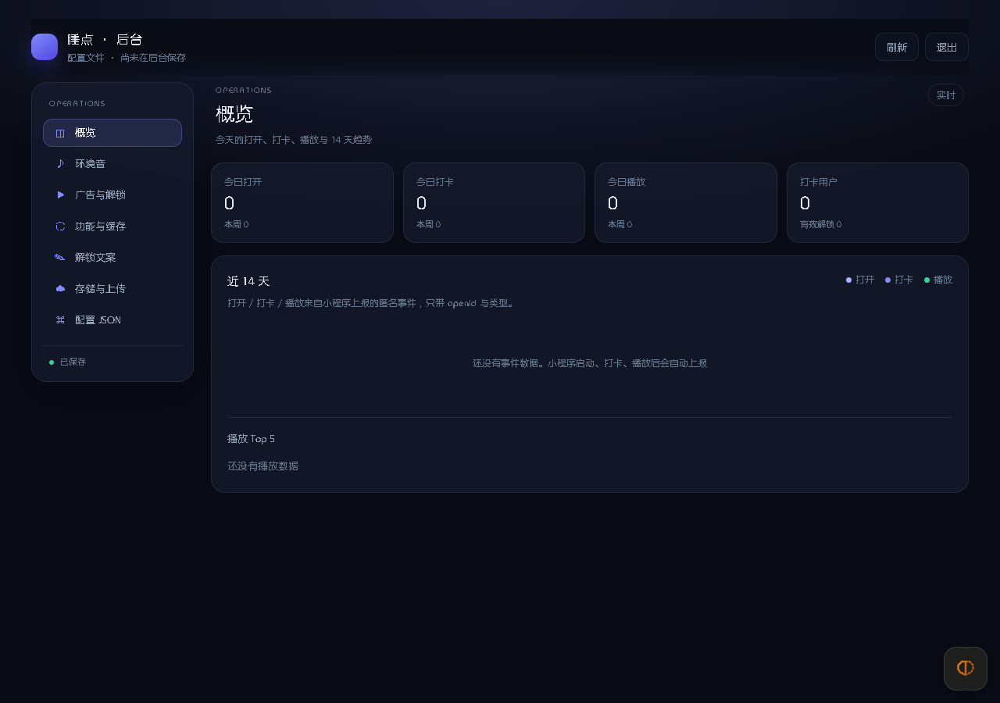
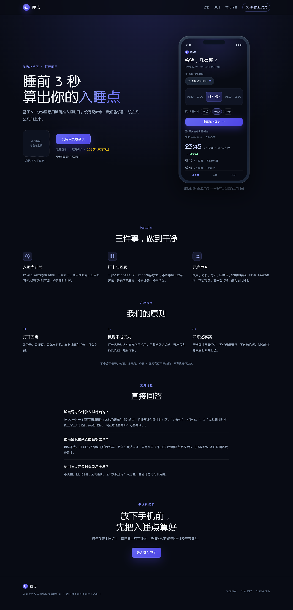

# 睡点 · 微信小程序

极简睡眠时间计算 + 一键打卡 + 环境音。零登录、零授权、数据默认只存本机、只有深色主题，前后端分离。

当前是 **L4 商业交付候选（2026-10-20 深审修复已落地）**：三 tab 小程序、audio-dock、Express/PG 后端、后台管理、H5 演示与部署文件已就位。融合了同产品另一实现的 audio-dock、真 3D 翻转、A/B/C 打卡态、横向热力图与海报/清除数据。AppID 已切到 `wx378b0a7437d60998`；还缺真实 ICP 备案号、AppSecret、1Panel 线上部署、广告位/真实 COS 与真机验收。改后模拟器已复验背景显示与时间轮拖动。

## 当前状态

| 项 | 状态 |
|---|---|
| 3 个 tab（计算器 / 入睡 / 统计）+ audio-dock 声音抽屉 | ✅ 已实现，深色玻璃视觉 |
| 通栏透明顶栏 + 悬浮“灵动岛” | ✅ 已实现，去掉固定原生导航条 |
| 90 分钟双向倒推、12h 时间轮、单卡 3D 翻转、A/B/C 打卡 | ✅ 2026-10-20 首页重构为双向单卡，有单测 |
| 云同步容错 / 单日墓碑 / 全量清除水位 / 解锁覆盖写 | ✅ 2026-10-19 加固，有回归测试 |
| 云备份默认关闭（数据本地化） | ✅ 统计页显式开启后才上传，可随时关闭；可单独删除云端副本 |
| 页面展示位（首页 / 入睡 / 统计 ×2） | ✅ 4 个槽位已接入，后台逐槽开关，默认全部关闭 |
| 广告观测 | ✅ `ad_show` / `ad_error` 上报，后台展示今日/本周与分槽填充率 |
| 跨页音频控制 | ✅ 声音入口仍在入睡页；播放后首页/统计页出现迷你播放器 |
| 页内分享 | ✅ 计算器结果、入睡页、统计页均有转发入口，文案随场景变化 |
| 首页 Hero 背景图 | ✅ 后台多图/分类/默认图/COS 上传；默认免费静默缓存，更换看广告解锁，到期回退默认 |
| 近 3 个月（月对齐）热力图 + 未来占位、周均值、海报、云同步/清除 | ✅ 已实现 |
| 后端公共接口 + 后台上传/配置/看板/用户数据 + PG 连接池 + 内存模式 | ✅ 已实现，有单测 |
| Dockerfile / docker-compose | ✅ 已实现，`docker compose config` 校验通过 |
| 后台管理 `/admin` | ✅ 左侧主菜单 + 右侧分类面板，浏览器实测保存 |
| 落地页 `/` + H5 交互演示 `/demo/` | ✅ 浏览器实测（H5 仍为旧版结构，色板已同步） |
| 134 个单元测试 | ✅ 133 通过 + 1 个 PG 集成用例（需 `PG_TEST_URL`） |
| AppID / 首条 COS 音频 | ✅ `wx378b0a7437d60998`；`https://img.qfmaster.com/sleep/sleep-10001.mp3` 可访问 |
| 微信开发者工具渲染 | ✅ 三页已编译、截图、无 console error |
| 真机音频 / 广告 / 锁屏 | ⚠️ 未验证，需要外部账号与真机 |


设计取舍与验收口径见 [修订版 PRD](docs/00-prd-revised.md)，接口与数据模型见 [架构说明](docs/01-architecture.md)。

## 目录

```
miniprogram/            小程序（原生 WXML/WXSS/JS，无第三方 UI 库）
  config/env.js         ← API 域名（开发/体验/正式自动切换）
  config/fallback.js    ← 服务端不可达时的兜底配置
  utils/                时间、统计、存储、请求、广告、展示位、背景图、同步、缓存、事件、跨页定时器
  components/           ambient / top-bar / time-wheel / audio-dock / heatmap / unlock-sheet / ad-slot / share-btn / now-playing / background-picker / empty-state
  pages/                index（计算器）/ sleep（入睡）/ stats（统计）
  assets/               tabBar 与音频图标
server/                 Express API（config / unlock / summary / sync / events / admin）
  config/app.config.json ← 种子与兜底配置（日常在 /admin 改）
  public/admin/          ← 后台管理页面
  public/site/           ← 落地页 + H5 交互演示
  sql/001_init.sql
  test/
docs/                   12 份文档 + 根目录 DECISIONS.md
tests/                  小程序纯逻辑单测
tools/                  资源生成、静态检查
```

## 快速开始

### 1. 小程序（不需要后端也能看计算器/入睡）

1. 微信开发者工具 → 导入项目 → 选择仓库根目录（`project.config.json` 已指向 `miniprogram/`）。
2. AppID 已写入 `wx378b0a7437d60998`，用该小程序的管理员/开发者微信扫码登录工具即可。
3. 详情 → 本地设置 → 勾选 **不校验合法域名**。开发版自动请求 `http://127.0.0.1:3100`，体验版/正式版自动请求 `https://sleep.qfmaster.com`（`config/env.js` 按 `envVersion` 切换，不用手改）。
4. 编译，计算器页直接可用；打卡数据写本地存储。

底部 tab 是 **计算器 / 入睡 / 统计**。声音不在 tabBar：从「入睡」页右下角“声音”进入底部抽屉，播放后变成迷你播放器，收起/切 tab 继续播放。视觉系统见 [改版说明](docs/09-redesign.md)。

环境音已接入 1 条 COS 音频（约 3 分钟，5.7MB），对外地址 `https://img.qfmaster.com/sleep/sleep-10001.mp3`。真机播放前，必须把 `https://img.qfmaster.com` 加入公众平台 → 开发管理 → 服务器域名 → **downloadFile 合法域名**；开发者工具里勾了“不校验合法域名”可直接试听。

### 2. 后端（内存模式，不需要 PostgreSQL）

```bash
cd server
npm install
# macOS / Linux
PORT=3100 DB_MODE=memory ALLOW_DEV_LOGIN=1 ADMIN_PASSWORD=local-admin node src/index.js
# Windows PowerShell
$env:PORT='3100'; $env:DB_MODE='memory'; $env:ALLOW_DEV_LOGIN='1'; $env:ADMIN_PASSWORD='local-admin'; node src/index.js
```

```bash
curl http://127.0.0.1:3100/api/health
curl http://127.0.0.1:3100/api/config
```

内存模式重启即丢，只用于联调；生产必须用 PostgreSQL。

### 3. 后台管理（不用改任何文件）

启动后端后打开：

```
http://127.0.0.1:3100/admin
```



- 密码就是 `ADMIN_PASSWORD`；没设置时，服务端启动日志会打印本次临时密码。
- 能改：环境音（名称/分类/地址/图标/顺序/增删/上传）、广告位与解锁有效期、功能开关、缓存上限与有效期、解锁文案。
- 能看：今日/本周打开、打卡、播放、用户数，14 天趋势，播放 Top 5。
- “存储与上传”里填 COS 的 Bucket / Region / SecretId / SecretKey，可直接上传音频；SecretKey 加密入库、不回显。
- 保存写入数据库 `app_config` 表，接口立即生效；小程序最多 10 分钟后拉取新配置，重开小程序则立即生效。
- `server/config/app.config.json` 只是首次部署的种子与数据库故障时的兜底，日常不用手改。
- 详细说明见 [后台管理文档](docs/05-admin.md)。

### 4. 落地页与 H5 演示

同一个 API 进程直接提供：

```
http://127.0.0.1:3000/          落地页
http://127.0.0.1:3000/demo/     H5 交互演示（打卡 / 热力图 / 音频 / 模拟广告解锁）
```



H5 读取同一份 `/api/config`，后台改音频或文案会同步反映；演示数据只存浏览器 localStorage，广告是 5 秒倒计时模拟。

### 5. 后端 + 数据库（Docker）

```bash
cp .env.example .env      # 填 POSTGRES_PASSWORD、WX_APPID、WX_SECRET、ADMIN_PASSWORD、CONFIG_SECRET、TRUST_PROXY=1
docker compose up -d --build
curl http://127.0.0.1:3000/api/ready
```

生产推荐 **1Panel 反向代理**：域名 `sleep.qfmaster.com` → `http://127.0.0.1:3000`，证书由 1Panel 申请；完整步骤见 [部署 Runbook](docs/08-deploy-runbook.md)。只有没有 1Panel/Nginx 时才用 `docker compose --profile https up -d` 的 Caddy。

`/api/ready` 会在数据库不可用时返回 503；`/api/health` 只用于看进程状态。生产环境缺少 `ADMIN_PASSWORD` 会直接启动失败。

`NODE_ENV=production` 下有三道启动保护：缺微信密钥、开 `ALLOW_DEV_LOGIN`、用内存库，都会直接启动失败，避免带病上线。

## 常用操作（标准口令）

```bash
# 本地极客混跑：PostgreSQL 在 Docker，API 在宿主机 3100
npm run dev:geek

# 只检查环境
powershell -File deploy/dev.ps1 -Check

# 打包：先跑 134 测试 + 静态检查，再生成 zip/SHA256
npm run pack -- -Label 20261019-l4
```

- **说“启动极客混跑模式”** → 执行 `npm run dev:geek`。
- **说“打包部署”** → 执行 `npm run pack`，然后按 [常用操作](docs/10-operations.md) 上传最新 zip 到 1Panel。
- **说“检查部署配置”** → `npm run deploy:check`。

极客混跑的后台：`http://127.0.0.1:3100/admin`，本地临时密码 `getsleep-local-admin-2026`。完整参数、停止/重置、1Panel 上传/反代/证书步骤见 [docs/10-operations.md](docs/10-operations.md)。

## 配置在哪

| 要改什么 | 改哪里 |
|---|---|
| API 域名 | `miniprogram/config/env.js`（开发/体验/正式自动切换，通常不用改） |
| 音频列表 / 解锁广告位 / 功能开关 / 缓存 / 解锁文案 | **后台 `/admin`**（写 `app_config` 表）；`server/config/app.config.json` 仅作种子与兜底 |
| 页面展示位开关 / 广告位 ID / 类型 | **后台 `/admin` → 广告与解锁 → 页面展示位**（4 槽独立开关，默认关闭） |
| 首页背景图 / 默认图 / 解锁时长 / 上传 | **后台 `/admin` → 背景图**（多图、分类、默认图、COS 上传；用户更换需看广告解锁） |
| COS 凭证与音频/背景图上传 | 后台 `/admin` → 存储与上传（SecretKey 加密入库） |
| 后台登录密码 / 加密密钥 | `.env` 的 `ADMIN_PASSWORD`、`CONFIG_SECRET` |
| 数据库、微信密钥、限流阈值 | `.env`（参考 `.env.example`） |
| 颜色、圆角、字号 | `miniprogram/app.wxss` 与各页面 `wxss` |

`adUnitId` 留空 = 客户端直接解锁（开发期与未开通流量主时的正式降级路径）。

## 验证

```bash
npm test        # 134 个测试：时间、统计、双向倒推、热力图/墓碑、分片同步、API、后台鉴权/事件/COS 配置/用户记录删除、启动来源归一化、看板聚合、小程序码服务、展示位配置校验、同步总闸、云端副本删除、本地事实回顾、背景图逻辑与后台配置、播放器回退/缓存并发/同步批量写入；PG 集成用例需 PG_TEST_URL
npm run check   # JSON / WXML 标签 / WXSS 括号 / 页面四件套 / 组件引用 / CSP inline 检查
```

本次实际执行结果：

- `npm test`：133 passed / 0 failed + 1 个 PG 集成用例（未设置 `PG_TEST_URL` 时跳过）
- `npm run check`：通过（19 JSON / 14 WXML / 15 WXSS），主包约 319.0 KB
- 后端内存模式冒烟：`/api/health`、`/api/config`、`/api/summary`、`/api/audio/unlock`、`/api/records/erase` 均符合预期
- **PostgreSQL 16 容器端到端**：自动建表、解锁写入 24 小时、`sync` 幂等、空记录同步能取回 3 条（换机回填）、`summary` 正常返回、后台配置重启后仍在
- **后台浏览器实测**：登录、保存（写库并立即改变 `/api/config` 与解锁 TTL）、环境音增删、COS 音频试听、存储面板、14 天趋势渲染、无未捕获 JS 错误
- **H5/落地页浏览器实测**：三 Tab 切换、填充演示数据、热力图、音频解锁与回退、播放器状态
- `docker compose config`：通过
- 生产配置三道保护：均按预期启动失败

**已补验**：微信开发者工具三页真实编译/截图、时间轮 12h 循环与上午/下午、透明顶栏/灵动岛、后端配置拉取、控制台无 error。

**仍未验证**：audio-dock 抽屉完整交互、海报、真机后台音频、锁屏续播、激励视频、真机网络请求。这些必须在真机上逐项过 [验收清单](docs/00-prd-revised.md#8-验收清单)。

## 已知限制

- 环境音目前只有 1 条（`https://img.qfmaster.com/sleep/sleep-10001.mp3`，标题“雨声”），更多音频在 `/admin` 上传；COS 域名需加入 `downloadFile` 合法域名。
- 服务端 AppSecret 未写入仓库，必须自己填到 `.env`；不填时只能以 `ALLOW_DEV_LOGIN=1` 做本地联调。
- 内存模式下后台保存的配置重启会丢（页面会提示“内存（重启丢失）”），正式环境请用 PostgreSQL。
- 若 COS 开了防盗链，必须放行 `servicewechat.com`，否则小程序内音频会 403；H5 演示还需放行站点域名（演示页失败会回退本地测试音）。
- 后台退出只清 Cookie，已签发会话 7 天内仍有效；需要强制下线时更换 `ADMIN_SECRET` 并重启。
- 单实例：限流、配置缓存、事件队列都在进程内，扩容前需要改造。
- 后台上传走服务器中转，3M 带宽下 5MB 文件约十几秒；后续可改 COS 预签名直传。
- H5 是演示：广告是倒计时模拟、数据只存 localStorage、回顾句本地生成；**H5 仍是改版前的结构，只同步了色板**，小程序以 `pages/` 为准。
- 后台音频不支持混音；`定时关闭` 已持久化并在回到前台/音频结束时校时，但 iOS 完全冻结 JS 时仍可能延后。
- 撤销打卡会写本地墓碑并在下一次 sync 上传 `deletedDays`；彻底删除请用统计页“清除数据”。未开云备份时本地立即清除，并保留云端副本重试入口；已开启时先调 `POST /api/records/erase` 写 erasure 水位。清除会同时清理解锁、收藏、计算偏好和缓存，弹窗已逐项说明。
- 云备份按每片 60 条分片，覆盖最近 400 天；不再只上传 60 天。
- 收藏只在本机（`meta.favoriteAudioIds`），不参与云同步，换机不迁移。
- 小程序内不做订阅/会员支付（iOS 虚拟支付受限），也没有预留支付链路。
- 页面展示位默认关闭；未开通流量主或广告位未审核时，即使后台勾选，`<ad>` 组件报错后也会静默隐藏，不影响页面布局。
- 云备份默认关闭；关闭状态下睡眠记录不上传，本周事实回顾由本地模板生成。匿名事件只含类型、音频 id 与时间，不含睡眠明细，可在后台关闭。
- 关闭云备份后可在统计页单独删除云端副本（`cloudOnly`，不写 erasure 水位，本机记录保留）；删除会等结束在途同步并换 epoch，防止旧响应把记录写回。
- 后台“用户数据”删除会写全量清除水位：用户下次同步时本机旧睡眠记录也会被清除；后台已把这条写进确认文案。
- 背景图：最多 20 张、单张 ≤5MB；后台上传时默认在浏览器端压缩为 webp（最大 1440×1920、质量 0.82），webp 反而更大或编码失败时保留原图；上传处可勾选「保留原图」跳过压缩（默认不勾选）。服务端只负责存 COS。小程序按宽度等比完整显示（widthFix，不裁切）。默认图免费静默缓存，用户更换非默认图会中断当前付费图并弹窗说明；解锁时长 1–168 小时，到期自动回退默认图。背景缓存最多 6 张，淘汰/清除时会删除本地文件。
- 限流是进程内实现，多实例部署会失效。

## 文档

0. [当前上下文 context.md](context.md) —— 代码事实、配置边界、部署幂等与待决策
0.5 [设计决策 DECISIONS.md](DECISIONS.md) —— 18 条 ADR（睡眠日、圆均值、LWW、模板总结、午休范围、同步容错、删除水位、1Panel、不做付费内容、不做分享解锁等）
1. [修订版 PRD](docs/00-prd-revised.md) —— 范围、页面规格、算法口径、与原始 PRD 的 10 处差异、验收清单
2. [架构与接口](docs/01-architecture.md) —— 目录、数据模型、API 契约、降级矩阵、安全
3. [实施计划](docs/02-implementation-plan.md) —— 阶段、验证命令、待外部输入
4. [上线清单](docs/03-launch-checklist.md) —— 账号、类目、域名、COS、广告、隐私、提审话术
5. [后台管理](docs/05-admin.md) —— 登录、左菜单配置、COS 上传、看板、安全与常见问题
6. [素材清单](docs/04-assets.md) —— 音频/图标的文件、参数、授权留证
7. [H5 与落地页](docs/06-h5-and-landing.md) —— 演示范围、一致性、已知差异
8. [代码审查报告](docs/07-code-review.md) —— 发现的问题、修复状态、剩余风险
9. [部署 Runbook](docs/08-deploy-runbook.md) —— 首次部署、HTTPS、备份、回滚
10. [改版说明](docs/09-redesign.md) —— 三 tab、通栏灵动岛、时间轮、audio-dock、跨页定时器
11. [常用操作](docs/10-operations.md) —— 极客混跑、打包、1Panel 部署的标准口令
12. [关键更新](docs/11-changelog.md) —— 2026-10-19 同步/删除/解锁/交互加固记录

## 下一步

1. 打开 `/admin`，填 COS 存储配置，把音频标题、分类、广告位、缓存参数调对。
2. 在 COS 防盗链放行 `servicewechat.com`，配置 `downloadFile` 白名单，真机跑通“播放 → 锁屏 → 解锁 → 定时关闭”。
3. 在后台补齐到 4–6 条环境音，确认分类、搜索与收藏。
4. 按 [上线清单](docs/03-launch-checklist.md) 提审。
5. 下一轮产品项：午休/多次睡眠独立记录、后台改密码（DB 哈希 + 会话失效）、H5 对齐新版。


