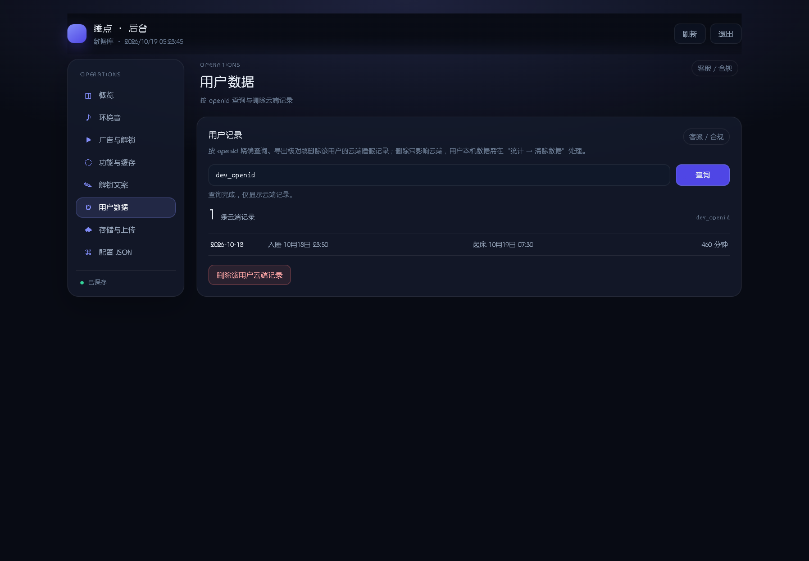

# 睡点 · 后台管理

- 入口：`https://sleep.qfmaster.com/admin`（本地：`http://127.0.0.1:3100/admin`）
- 代码：`server/public/admin/`，无需构建，随 API 一起部署

## 1. 登录

密码来自服务端环境变量 `ADMIN_PASSWORD`。

没设置时，服务端每次启动会生成临时密码并打印在启动日志里：

```bash
docker compose logs -f api
# [admin] 未设置 ADMIN_PASSWORD，本次启动临时密码：xxxxxxxxxxxx
```

正式环境请在 `.env` 里设置：

```ini
ADMIN_PASSWORD=换成你自己的密码
ADMIN_SECRET=
CONFIG_SECRET=
```

> 生产环境（`NODE_ENV=production`）缺少 `ADMIN_PASSWORD` 会直接启动失败，不会用临时密码上线。

- 登录状态是 HttpOnly + SameSite=Strict 的签名 Cookie，7 天有效。
- 生产环境 Cookie 带 `Secure`，**必须 HTTPS 访问**，否则登录不上。
- 登录接口限流 5 次/分钟/IP；改密接口有独立限流桶（同样 5 次/分钟/IP），失败重试不挤占登录额度。
- `CONFIG_SECRET` 用于加密 COS 凭证；不设置时退化为 `ADMIN_SECRET` / `ADMIN_PASSWORD`。若后台密码是启动期随机生成的，COS 凭证将无法跨重启保存，页面会给出提示。

### 1.0.1 修改后台密码（2026-10-23）

左菜单「安全」面板：填当前密码 + 新密码（≥8 位）+ 确认 → 修改。

- 密码以 scrypt（随机盐）哈希写入数据库 `admin_credentials`，不落明文；**落库后 `.env` 的 `ADMIN_PASSWORD` 不再可用**（env 只做首次引导，避免轮换后留后门）。
- 修改成功后所有已签发会话立即失效（令牌版本变化），需要用新密码重新登录；该动作写进「操作日志」。
- 内存模式（`DB_MODE=memory`）改密只在本进程内生效，重启回退 env 密码，面板会明确提示。
- 忘记密码的恢复路径：删除数据库里 `app_config` 表中 `key = 'admin_credentials'` 的行并重启，即回退到 env 密码。

## 1.1 后台布局（2026-10-19）

改成 **左侧主菜单 + 右侧单面板**，不再把所有配置拉成一条长页：

- 左：概览 / 环境音 / 背景图 / 广告与解锁 / 功能与缓存 / 小程序与提醒 / 解锁文案 / 落地页 / 国际站 / 用户反馈 / 用户数据 / 操作日志 / 安全 / 存储与上传 / 配置 JSON。
- 右：只显示当前分类；切换菜单不会丢掉未保存的修改，左侧状态点会提示“有未保存修改”。
- 配置类面板底部是 sticky 保存条；存储面板有独立的“保存存储配置/测试连接”。
- 宽度 ≤860px 时左菜单自动变成顶部横向 tabs，手机/窄窗口也能用。
- 概览保留今日指标、14 天趋势、播放 Top 5，以及「音频解锁观测」（成功/失败/加载失败率/失败原因，口径均为本周）；环境音列表、上传、试听仍在“环境音”面板。


## 2. 能改什么

| 区域 | 可改 | 生效范围 |
|---|---|---|
| 数据看板 | 今日/本周打开、打卡、播放、用户数，14 天趋势，播放 Top 5，打开来源 Top 5 | 只读 |
| 音频解锁观测 | `audio_unlock` 成功、`audio_unlock_fail` 失败、加载失败率与原因（跳过/忙碌/加载失败/不可用） | 只读；加载失败率 =（error + unavailable）/（成功 + error + unavailable），排除用户跳过/忙碌 |
| 广告位观测 | `ad_show` / `ad_error` 的今日/本周展示与失败、近 14 天填充率、分槽展示/失败 | 只读；来自小程序 `ad-slot` 上报 |
| 环境音（音频清单） | 名称、副标题、分类、COS 地址、图标、**收藏基数**（0–99999）、顺序、增删（1–10 条）、上传 | 小程序 audio-dock：列表第二行显示「基数 + 真实收藏 人收藏和喜欢」，并按该值降序排列 |
| 背景图 | 名称、分类、COS 地址、启用、顺序、**人气基数**（0–99999）、增删（≤20 张）、上传；默认背景图与解锁时长（1–168 小时） | 首页 Hero 背景；免费模式下非默认项第二行显示「已被使用 N 次」（基数 + 真实使用，0 人回落「可随时更换」），默认项仍「默认背景」、已解锁项仍「已解锁 · 剩 N 小时」。默认图不涉及解锁，用户更换需看广告（`free` 模式直接更换）。小程序界面不出现「免费」字样，避免让人以为存在收费项。小程序按宽度等比完整显示（widthFix，不裁切）。上传时默认浏览器端压缩为 webp（最大 1440×1920、质量 0.82），webp 更大或失败时保留原图；可勾选「保留原图」跳过压缩 |
| 广告与解锁（解锁规则） | 解锁方式、广告位 ID、有效期 1–168 小时、广告失败策略 | 解锁逻辑与 `/api/audio/unlock` |
| 广告与解锁（页面展示位） | 首页最下方、入睡按钮下方、统计页内容下方、统计页最下方 4 个槽位的开关、广告位 ID、类型（原生模板 / Banner） | 小程序对应页面；默认全部关闭，未启用不渲染、不占空间；加载成功/失败会上报 `ad_show` / `ad_error` |
| 功能与缓存（开关与缓存） | 事实回顾、云端备份、匿名事件统计、定时关闭、进入即预加载、用户反馈；缓存上限 20–200MB、有效期 1–30 天 | 小程序功能开关与本地缓存；「用户反馈」关掉后统计页入口隐藏，且 `POST /api/feedback` 返回 403（旧版本客户端也拦得住） |
| 解锁弹窗文案（文案字段） | 标题、说明、确认/取消按钮 | 小程序解锁面板 |
| 用户反馈 | 只读列表（按时间倒序最多 200 条，可勾「只看未处理」）、标记已处理 | 小程序「统计 → 反馈与建议」；正文按纯文本渲染（`textContent`），标记动作写 `admin_audit`（只记编号，不落正文与联系方式）。**不提供删除**——用户「清除数据」会级联删干净，避免两套删除语义 |
| 用户数据 | 按 openid 查询云端记录/解锁/事件计数、删除该用户全部云端数据（睡眠/解锁/收藏/背景使用/事件/提醒/反馈） | 客服/合规删除；删除会写清除水位，用户下次同步时本机旧记录也会被清除；在途写入不会写回；审计落库 `admin_audit` |
| 存储与上传（COS 配置） | Bucket、Region、访问域名、存储路径、SecretId、SecretKey | 后台音频上传 |

每条音频都可以“试听”，浏览器直接播放 COS 地址。

**不在这里做的事**：AppID/AppSecret/API 域名（属于发布与启动配置；开发/正式域名已由 `config/env.js` 自动切换）、多管理员、支付。用户记录删除会写入 `admin_audit` 审计表（openid 哈希前缀、条数、erasedAt），并同时打一条日志。

## 3. 音频上传（COS）

1. 先在“存储与上传”填 Bucket / Region / SecretId / SecretKey，保存。
2. 点“测试连接”确认权限；它会用一次最小 PutObject 写 `.connectivity-test`，所以只需该桶的写入权限，不需要 List。
3. 点“上传音频”选择文件，上传完成后会自动追加一条环境音。
4. 改名称、分类，点“保存并生效”。

细节：

- 支持 mp3 / m4a / aac / wav / ogg，单个 ≤ 25MB。
- 存储路径默认 `sleep/`，对象名自动加时间戳与随机串，不会覆盖。
- 「收藏基数」是**展示起点**，不是真实用户数：前台显示 `基数 + 真实收藏`（表 `audio_favorites`，一人只算一次，取消会减 1）。0 人时前台回落「点击播放」，不会出现「0 人收藏」。旧后台标签页不提交该字段时按同 id 沿用已生效值，不会清零。
- 背景图的「人气基数」同理：前台「已被使用 N 次」= 基数 + `background_uses` 累计次数（同一人换用多次算多次，与收藏不同）。0 次时免费模式回落「可随时更换」，默认图与已解锁图不显示次数（显示「默认背景」「已解锁 · 剩 N 小时」）。
- SecretKey 用 AES-256-GCM 加密后写入 `app_config`，接口只返回 `hasSecret`，不回显明文。
- 建议用只有该桶写入权限的子账号，不要用主账号密钥。
- **防盗链**：如果 COS 开了防盗链，必须放行 `servicewechat.com`（小程序请求的 Referer），否则小程序里会播放失败。H5 演示还需放行它自己的域名，或本地调试时暂时关闭防盗链。

上传走服务器中转（浏览器 → API → COS），3M 带宽下 5MB 文件约需十几秒，界面有进度。

### 3.1 用户数据（客服/合规）

“用户数据”面板支持按 **openid 精确查询**和删除：

- 查询：`GET /api/admin/users/:openid`，返回该 openid 的云端记录（日期、入睡、起床、时长）、解锁到期时间与事件数。**只返回面板展示的字段**（不返回完整睡眠段明细），查询动作写审计。
- 删除：`DELETE /api/admin/users/:openid/records`，删除该 openid 的 `sleep_records`、`audio_unlocks`、`audio_favorites`、`background_uses`、`events`、`sleep_reminders`、`user_feedback` 与单日墓碑，并写 `user_erasures` 水位。
- **该操作不只删云端**：水位会让用户下次同步时清除本机旧睡眠记录（不可恢复）。后台确认弹窗已明确提示；无睡眠记录但有解锁/事件数据的用户也可删除。
- **在途请求不会写回**：所有带 openid 的写入（解锁、提醒、反馈、收藏、背景使用、记录同步、事件）共用同一把 subject 锁与清除水位判定；清除前已发出的请求即使晚到也会被拒（409 `DATA_ERASED`）。清除水位只前进不后退。
- 回执：删除后返回各类别的删除条数（睡眠/解锁/事件/提醒/反馈/收藏/背景使用），并写入审计。
- 审计：写入 `admin_audit` 表（只记 openid 哈希前缀、条数、erasedAt），同时打日志，便于容器日志轮转后追溯。
- openid 属于用户标识，不要截图外发；查询框不会把 openid 写入页面历史。



## 4. 数据看板

只统计客户端上报的轻量事件（主要如下）：

| 事件 | 触发 | 用途 |
|---|---|---|
| `app_open` | 小程序启动 | 今日/本周打开人数 |
| `checkin` | 记录起床（完成一次打卡） | 打卡次数与打卡用户 |
| `audio_play` | 开始播放某条环境音 | 播放量、Top 5 |
| `audio_unlock` | 看完广告解锁成功 | 解锁次数 |
| `audio_unlock_fail` | 激励视频未看完、忙碌、加载失败或不可用 | 广告加载质量与放行漏损；target=`原因|音轨id` |
| `audio_interrupt` | 来电/闹钟/其他 App 中断 | 中断频次与恢复结果 |
| `manual_sleep` | 入睡页/统计页补记成功 | 补记次数 |
| `share` | 分享按钮触发 | 分享漏斗分母 |
| `ad_show` / `ad_error` | 页面展示位加载成功/失败 | 展示位填充率 |

- 只带 openid、事件类型、音频 id 与时间戳，不上传睡眠明细、设备信息、位置。
- 事件保留 180 天，服务端每 6 小时清理过期数据。
- 关闭“云端备份”不影响事件（事件是匿名计数，不含记录内容）；如果完全不想上报，可在服务端停用 `/api/events` 或在客户端去掉 `utils/events.js` 调用。
- 打卡用户数取“服务端已有记录的去重用户”和“14 天内打卡事件用户”的较大值，避免只开看板不备份时显示 0。

## 5. 配置存在哪、多久生效

优先级：

```
数据库 app_config 表  >  server/config/app.config.json  >  miniprogram/config/fallback.js
```

- 后台保存后写入数据库，版本号自增，API 立即生效。
- **发布版本（revision）**：每次保存 +1，后台顶栏可见；它是并发保存的判据（服务端原子 CAS，冲突返回 409，不会静默覆盖）。
- 服务端有 30 秒内存缓存，保存时会主动刷新。
- 客户端最多复用 10 分钟配置缓存；页面 `onShow` 会按 TTL 检查，下拉刷新统计页可强制拉取，重开小程序也会立即拉取。
- 第一次保存后，数据库配置成为唯一来源，之后再改 JSON 文件不会覆盖它。
- `DB_MODE=memory` 时配置存在进程内存里，重启恢复文件配置，页面会显示“内存（重启丢失）”。正式环境请用 PostgreSQL。

## 6. 安全边界

- 单管理员密码，没有注册、没有多用户。
- **支持在页面内改密码**（见 §1.0.1）：scrypt + 随机盐入库，改密后所有会话立即失效，动作写审计。
- **凭据读取失败即关闭后台登录**：启动时若读不到库内凭据（不是「没有凭据」而是「读失败」），服务端不会回退 `.env` 的 `ADMIN_PASSWORD`，而是让后台登录返回 503（`ADMIN_AUTH_UNAVAILABLE`），小程序端接口不受影响。需要恢复时按 §1.0.1 的路径处理凭据后重启。
- 生产环境的 `ADMIN_PASSWORD` 至少 8 位（与网页改密同一规则），启动时校验。
- 会话是签名 Cookie，不落库；退出只清浏览器 Cookie。要强制所有会话失效，改 `ADMIN_SECRET` 或更换密码后重启。
- 管理接口只接受同源 JSON 请求，配合 SameSite=Strict 防 CSRF。
- 页面带 CSP、`X-Frame-Options: DENY`，不允许被 iframe 嵌入。
- COS 密钥加密存储，日志与接口都不回显。
- **上传按文件内容校验**：不只看扩展名与 MIME，服务端按文件头字节识别真实类型（mp3/wav/ogg/m4a/aac、jpg/png/webp），伪装文件在进 COS 前被拒（400 `INVALID_FILE_CONTENT`）；同一时间最多 2 个上传并发。
- 密码、SecretKey 不要提交到仓库、不要发在聊天里。

### 6.1 并发保存与草稿保护

- 配置发布用**单调递增的发布版本（revision）**做原子 CAS：后台保存携带载入时的版本号，期间若有人先保存过，服务端返回 409 `CONFIG_CONFLICT`，不会静默覆盖对方的改动。顶栏会显示当前发布版本号。
- 遇到 409 时**不会自动重载**：页面保留你的未保存修改，并让你明确选择「载入最新版本」或「以最新版本为基线覆盖保存」。
- 保存期间不能重复提交；如果你在保存期间又改了内容，响应只更新基线、不会覆盖新草稿，并提示再保存一次。
- 会话过期（401）时**保留草稿**：重新登录后未保存的修改仍在页面上。退出与改密会先提醒处理未保存内容；改密在有未保存修改时会被拦下。

## 7. 常见问题

| 现象 | 原因 / 处理 |
|---|---|
| 打开 `/admin` 一直要求登录 | 生产环境用了 http，Secure Cookie 被丢弃；换 https |
| 登录提示密码不正确 | 看启动日志里的临时密码，或检查 `.env` 的 `ADMIN_PASSWORD` 是否重启后生效 |
| 保存 COS 提示缺少安全密钥 | 服务端没设固定 `ADMIN_PASSWORD`/`CONFIG_SECRET`；补上后重启 |
| 上传报“请先配置 COS” | 存储面板还没保存完整，或 SecretKey 因更换密钥无法解密，需要重填 |
| 上传 403 | 子账号没有 `PutObject` 权限，或 Bucket/Region 填错 |
| 小程序播放失败 / H5 播放 403 | COS 防盗链拦截；放行 `servicewechat.com` 与 H5 域名，或关闭防盗链 |
| 改了配置小程序没变化 | 切回前台等 10 分钟缓存过期、下拉刷新统计页强制刷新，或重开小程序；确认 `env.js` 指向同一台 API |
| 保存报“数据库暂时不可用” | PostgreSQL 没起来或 `DATABASE_URL` 错；看 `/api/health` 的 `db` 字段 |

## 8. 为什么不做完整 CMS

当前是单管理员、单实例、配置项固定的轻量后台，已经覆盖“不改代码不发版就能调音频、广告、文案、开关、看数据”。

再往上（多角色、审计日志、素材版本、灰度）需要权限模型和操作日志，属于有运营团队后的需求，现在做会拖慢上线。
