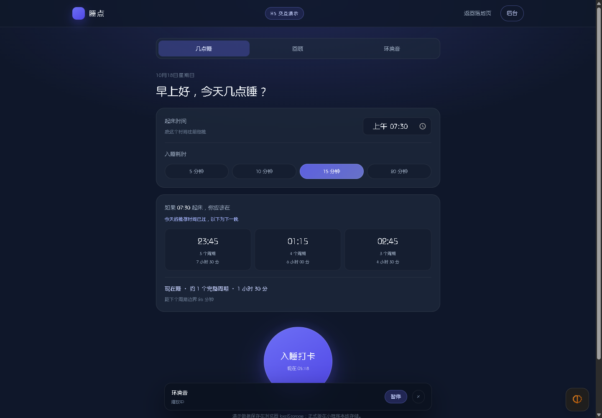
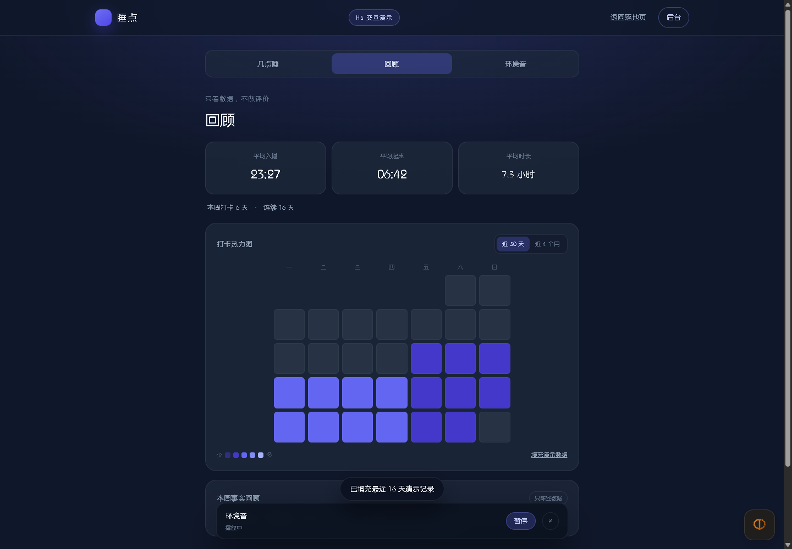

# 睡点 · H5 演示与落地页

- 落地页：`/`
- H5 交互演示：`/demo/`
- 代码：`server/public/site/`，随 API 一起部署，无构建步骤

## 1. 为什么要做

小程序不方便截图和分享给非技术同事，H5 用同一套视觉把核心交互跑一遍：

- 90 分钟倒推、现在睡倒数、三态打卡
- 本周均值、连续天数、热力图、事实回顾
- 环境音分类 / 搜索 / 播放 / 模拟广告解锁 / 预加载状态

落地页负责对外解释产品，H5 负责让人点一遍。

## 2. 一致性

| 项 | 小程序 | H5 |
|---|---|---|
| 颜色 / 圆角 / 字号 | `app.wxss` | `site.css` + `demo.css`，同一组色值 |
| 倒推算法 | `utils/time.js` | `demo.js` 内同公式实现 |
| 打卡数据 | 本地存储 + 可选云同步 | localStorage |
| 音频列表 | `/api/config` | 同一个 `/api/config` |
| 广告解锁 | 微信激励视频 | 5 秒倒计时模拟 |
| 缓存 | `FileSystemManager` 落盘 | 浏览器 `preload` + HTTP 缓存 |
| 事实回顾 | 服务端模板 + 禁词校验 | 本地同结构模板 |

H5 是**演示**，不是第二套生产端：没有账号、没有支付、没有真实广告、数据只在本机。

## 3. 已知差异

- **H5 演示仍是改版前的信息架构**（计算器与打卡合并在首屏、声音是 tab）；小程序已改为「计算器 / 入睡 / 统计 + audio-dock 声音抽屉」，H5 只同步了色板，交互结构待下一轮重做。
- 模拟广告不产生收益，也不能校验 `isEnded`。
- H5 的“缓存”是浏览器行为，不能像小程序那样精确管理文件、TTL 和容量。
- H5 的回顾句在本地生成，正式版必须走 `/api/summary`。
- 落地页里的手机外壳是静态示意图，不是小程序渲染截图。

## 4. COS 防盗链

音频 URL 在浏览器里可能被 COS 防盗链按 Referer 拦截：

- 小程序需要把 `servicewechat.com` 加入 COS 防盗链白名单（或允许空 Referer）。
- H5 演示需要放行它自己的域名；本地调试可暂时关闭防盗链。
- 演示页检测到加载失败会回退到 `demo-ambient.wav`（本地生成的 10 秒褐噪声），并在缓存状态里说明，不会静默失败。

## 5. 截图

