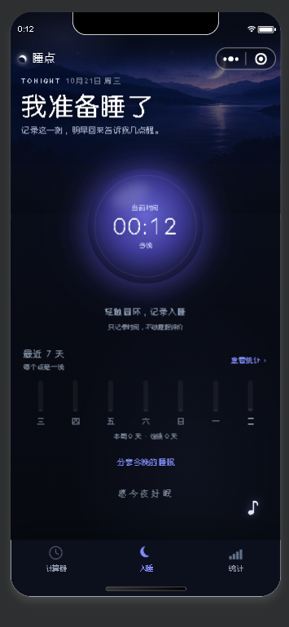
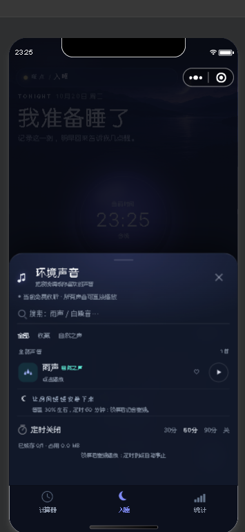

# 睡点 · 入睡页与环境声音抽屉升级

> 日期：2026-10-20  
> 范围：`pages/sleep`、`components/audio-dock`、新增 `components/hero-backdrop`  
> 原则：复用计算器页已有视觉事实，不改睡眠记录、云同步、音频解锁和定时关闭的数据逻辑。

## 1. 复用的计算器页视觉事实

- 顶部背景图从状态栏后开始，底部渐隐到夜色；内容层 `z-index` 高于背景。
- 大标题 72rpx、700 字重，说明文字 24rpx；日期/状态用 18–22rpx 的轻量信息层。
- 页面主体不再套大卡片，内容直接落在背景上；只保留间距、细分隔线和字号层级。
- 紫蓝色主色、月白色文字、低饱和辅助文字；不使用新的色板。
- 触控区至少 80–88rpx；视觉小的按钮用伪元素扩展命中区。
- 翻转/3D 只服务计算器的结果面，普通页面不进入 3D 上下文。

## 2. 入睡页

### 2.1 Hero

- 新增 [hero-backdrop](../miniprogram/components/hero-backdrop/hero-backdrop.js) 组件，复用后台背景图、分类/解锁选择和本地缓存回退；入睡页与计算器页使用同一张当前背景。
- 标题改为参考稿的「我准备睡了」，副标题「记录入睡这一刻，醒来后再记起床。」；入睡/完成态会切换为「这一觉开始了」「这一觉记下了」（2026-10-22 文案中性化：睡眠事件描述不写「夜色/今晚/明早」，白天补觉同样成立，详见 changelog）。
- 顶部面包屑去掉：入睡/统计页只保留「睡点」品牌，不再显示「睡点 / 入睡」「睡点 / 统计」。
- 环境声音入口保留为右下角悬浮 `♪`，2026-10-21 改为「页面主题深色 + 透明玻璃」圆底（`rgba(8,11,20,.46)` + `blur(14rpx)`，无边框、无高光线），保留轻微上下浮动与柔光；不再放 Hero 文字按钮。

### 2.2 入睡圆环

- 取消打卡卡边框，圆环直接落在背景上。
- 圆环用径向渐变从中心向外淡出，边缘透明，背景色自然透出；外围三层柔光和缓慢呼吸，形成向外辐射的安静感。
- 中心只保留三级信息：`当前时间 / 23:24 / 今晚`；睡梦中变为 `入睡时间 / HH:MM / 已睡 X 小时 X 分`。
- 圆环下方只留一行「轻触圆环，记录入睡/起床」和一条极轻提示，不再显示状态胶囊。
- 保留原 A/B/C 状态机和全部文案/弹窗逻辑；B 态追加撤销入口。
- C 态（已完成）不再套卡片：大时长 + 入睡—起床时间轴 + 文字操作，和背景直接衔接。

### 2.3 睡眠轨迹圆盘（试做后已移除，2026-10-22）

- 原「最近 7 天」柱状图先试做 **24h 睡眠轨迹圆盘**（`components/sleep-disc`，canvas 2d + `utils/disc-geometry.js`），两轮运营反馈后**整体移除**：①「不能喧宾夺主上方的信息」→ 弱化为无发光/无渐变/细弧淡色/中心一行小字；②「与上面的入睡圆环基本表达一致、占空间」→ sleeping/idle 态圆盘是 orb 信息的第三个副本，且评估过的替代内容（环境声音入口/计算器摘要/睡眠知识）都与既有入口重复，遂移除。组件、几何模块与测试全部删除，勿再加回。
- **保留一行轻量统计**：原位置改为 `stats-strip`——「本周 X 天 · 连续 Y 天 · 查看统计 ›」单行（顶部分隔线、22rpx 弱化文字、0 数据不渲染），点击进统计页。入睡页不再放任何图表，趋势/汇总归统计页。
- 同轮完成态调整（保留）：大数字（当天总睡眠）下方时间线改**总睡眠口径**（多段「当天首段入睡 → 当天末段起床」，单段不变）；段列表右侧「修改 / 删除」文字按钮（加粗、异色、无边框），删除确认弹窗，唯一段提示整天撤销；主操作合并同行小按钮「继续入睡（开始计时）/ 补记入睡」。删除走 `storage.removeSession`（删空当天 = 撤销 + 墓碑）。

### 2.4 睡前熄灯（2026-10-22）

- 点「入睡」后进入**持久熄灯**（替换原 1.6s「晚安」动画）：全屏毛玻璃 `rgba(4,7,15,0.84)` + `backdrop-filter: blur(20rpx)`，不支持 blur 的机型由深底退回“接近关灯”；熄灯层内是熄灭态入睡时间（brightness 0.84）+ 顶部「晚安」+ 底部「轻触任意处唤醒」。
- tabBar 同步 `tabbar.hide()`（独立 root 压不住），唤醒时恢复；熄灯层 `catchtouchmove` 阻止滚动。
- 熄灯态 orb 不可点：任意点触 = 唤醒；唤醒后再点圆环才记录起床。唤醒后 30s 无操作自动回熄灯（页面根 `bindtouchstart` 重置）。
- 结束/补记面板、声音抽屉打开时，以及 done/idle 态与页面 onHide 不熄灯；`refreshAll` 尾部按状态收敛，保存/取消面板后恢复倒计时。

## 3. 环境声音抽屉

- 去掉解锁卡、搜索胶囊、分类胶囊、播放中卡片和单曲提示卡；抽屉内只保留细分隔线。
- 标题区是一个简单音符 + 一级标题，不再做圆形图标底。
- 解锁/免费状态压缩成一行小字；搜索是放大镜 + 底部细线；分类是 28rpx 纯文字 tab，选中项加粗并用 28×4rpx 短横线标记。
- 曲目行用「彩色图标底 + 标题字号 + 分类色 + 灰色状态」建立层级，不再有播放中整行底色。
- 播放按钮放大到 76rpx 圆形线性图标并单独命中，收藏心形放大到 36rpx；关闭抽屉仍用标题栏的收口 X。
- 当前曲目标题后保留三根微型电平；暂停时冻结并降低透明度。
- 只有一首曲目时，提示文字直接跟在列表后，抽屉高度随内容收短（`is-short`），不再留 86vh 空白。
- 标题区只保留「环境声音」和音符，移除副标题；免费模式下不再显示“当前免费收听”提示，锁定/已解锁状态仍保留。
- 定时关闭复用计算器「预计入睡耗时」的小胶囊：未选项纯文字，选中项淡紫底 + 细描边，不做整条深色轨道，也不再额外加分隔线。
- 移除列表下方的「让房间慢慢安静下来」建议卡，单曲时抽屉直接收紧。
- 定时关闭、缓存清理、解锁弹窗和底部安全区逻辑保持不变。
- 交互按钮（收藏/播放/分类/清理）通过伪元素把命中区补到约 88rpx。

### 3.2 抽屉精简（2026-10-28）

- 顶部不再插入「正在播放」行（该行只随 `currentId` 出现，点播放会把下方内容整体下推）。
- 播放状态改由当前行承担：标题/状态用 `--color-primary-soft`（与播放/暂停图标同色），有当前曲时其余行标题降到 `--text-secondary`、图标底降透明度（`scroll-view` 的 `has-current` 类，纯 CSS）。
- 已缓存标记由绿色 `↓` 改为暗灰 `✓`（`rgba(148,163,184,.55)`、28rpx/400）：箭头容易被读成「下载」，对勾只表示「本机已存」；点 ✓ / 长按单曲仍是删除入口（二次确认）。
- 底部移除缓存汇总、「清理」整库入口与「锁屏后继续播放」脚注（`cacheText/cacheCount/onCleanCache` 同步删除）；整库清理仍由统计页「清除数据」承担。
- 定时关闭固定贴抽屉底部（`margin-top:auto`），不加底框与背景；标签加粗、选中档位实心淡紫深字，剩余时间用 `--color-primary-soft`。
- 抽屉高度 `86vh → 68vh`：顶边降到屏高 32%，关闭 X 与标题栏进入拇指区；上部遮罩更大，点外部即可关闭。列表仍内部滚动，头部与定时块不随列表移动。
- 标题行加同行小副标：「环境声音」+ 22rpx 淡字「陪着你，慢慢睡着」（`align-items: baseline`）。功能名保持可检索，陪伴感由副标承担；「结束播放」出现时不换行。

### 3.3 列表第二行：收藏人数与排序（2026-10-28）

- 曲目行第二行由固定「点击播放」改为关注人数：`713 人收藏和喜欢`（≥1 万显示 `1.2 万人收藏和喜欢`），给睡前选声音一个参考；当前播放行仍显示「正在连接音频… / 播放中 · 点击暂停 / 已暂停 · 点击继续」。
- **0 人回落「点击播放」**：冷启动既无后台基数也无真实收藏时，不显示「0 人收藏」；同时保留可点性暗示。已缓存状态不再写进文案（行尾 `✓` 角标承担）。
- 数据 = 后台 `audio[].favBase` 人气基数 + 服务端 `audio_favorites` 真实收藏（一人只算一次，取消减 1）。**接口只下发真实数 real，合成在客户端做**（`utils/audio-favorites.js` 的 `withRealCounts`，含单测）：运营调低基数后立即跟随，不会被旧展示值压住。
- 已缓存时第二行显示「已缓存 · N 人收藏和喜欢」（缓存信息与收藏人数共存，行尾 `✓` 角标仍是删除缓存入口）。
- 排序：全部/分类按收藏降序，同分保持后台配置顺序；「收藏」Tab 保持配置顺序。**排序用打开抽屉时的快照**——点 ♥ 只让数字 ±1、列表不重排，否则刚点的那行会当场跳走；下次打开抽屉再排。
- 失败降级：拉取人数失败静默保留基数；上报失败不回滚本地收藏，下次打开抽屉对账。

### 3.1 跨页播放状态与迷你条

- 修复入睡页与计算器/统计页状态相反的问题：`pageLifetimes.show` 重新读取 `BackgroundAudioManager` 的真实 `paused`，暂停/续播也以 `audio.paused` 为准，不再用可能滞后的 `data.playing`。
- 跨页时个别基础库会短暂清空 `audio.src`：播放条不再因 `src` 为空直接消失，改用 `lastTrackPlaying` + 本次启动的 `audioSession` 兜底；冷启动没有会话时仍不会画出残留播放条。
- 播放中：右缘显示**绿色 `♪` 吸附音符（无圆框/无底色）**；点击展开迷你播放条；播放中点播放条切到入睡页并打开环境声音抽屉。
- 入睡页 `audio-dock` 与跨页 `now-playing` 共用同一套视觉参数：音符 108rpx / 字形 66rpx / 右缘 26rpx / 底部 `176rpx + safe-area`（让出悬浮 tabBar 并拉开间距；2026-10-22 由 132rpx 整体上移 44rpx，tabBar 顶边在 128rpx），播放条 480rpx、右缘贴屏、左圆角、左侧 48rpx 留白，入场/收起都用同一段从右缘伸缩的位移+缩放动效。
- 暂停时：直接保留迷你播放条，显示粗一点的播放三角，方便继续。
- 迷你条信息恢复为「曲名 · 分类」+「均衡器 + 正在播放/已暂停 · 定时剩余」+ 播放/暂停；计算器/统计页的 `now-playing` 也改为同一套「播放中音符/暂停时播放条」交互，宽度收窄到 480rpx，右缘贴屏，从音符位置展开。
- 去掉容易误解的关闭 X：播放中或暂停时点击播放条打开环境声音抽屉；点击条外只向右收缩回音符，不停止播放；“结束播放”收进抽屉标题栏，避免把折叠误当关闭。
- 播放器宿主加独立 stacking context，并抬到页面主按钮上方，避免透明音符被底部按钮拦截点击；计算器/统计页用 `np-host` 包裹 `now-playing`。
- 计算器/统计页的播放条点击不再只切 tab：设置一次性 `openAudioSheet` 标记，入睡页 `onShow` 消费后打开抽屉。
- 播放/暂停图标加粗到 7rpx 笔画，命中区仍为 88rpx；播放条不再放关闭 X。

## 4. 悬浮居中 tabBar

- `app.json` 的 `tabBar` 改为 `custom: true`，原生底栏隐藏，使用 `custom-tab-bar/index` 渲染悬浮胶囊。
- 胶囊左右各留 24rpx，底部 `16rpx + safe-area`，高 112rpx；实色深蓝底、极细描边和轻阴影，不做渐变/内高光。
- 中间「入睡」用 158rpx 同色圆形凸起 + 淡紫月晕，左侧细线时钟、右侧四根细柱；月牙用 CSS 圆形缺口切出，避免字体符号粗细不一致。
- 当前页用图标/文字提亮 + 文字 `500` 字重表示，非当前页统一低对比灰；点击用 `wx.switchTab`，三个页面在 `onShow` 同步 `selected`。
- 自定义 tabBar 是独立组件层，普通页面遮罩压不住；打开环境声抽屉/背景选择器时通过 `utils/tabbar.hide()` 主动隐藏，关闭时恢复，而不是只靠 z-index。
- 播放器整体从 `90rpx` 抬到 `132rpx + safe-area`，刚好在悬浮 tabBar 上方、计算器主按钮下方；2026-10-22 三页（入睡/计算器/统计）再统一上移 44rpx 到 `176rpx + safe-area`，与悬浮胶囊拉开 48rpx 间距。

### 4.1 背景、浮层与玻璃

- 统计页补 `<hero-backdrop />`，和计算器/入睡页共用同一套后台背景图、下载缓存与渐隐 scrim。
- 计算器右上「换背景」缩到 56rpx 高、半透明底 + 细边，仍用伪元素保留约 72rpx 命中区。
- 播放条改为深色透明玻璃：`rgba(8,11,20,.62)` + `blur(26rpx)`、无边框；折叠音符为 108rpx 的同色系玻璃圆底（2026-10-22 改轻玻璃：`rgba(8,11,20,.30)` + `blur(18rpx)` + 柔阴影 `0 8rpx 22rpx rgba(0,0,0,.2)`——原 `.46` 实心感偏重，内容从音符后面穿过时像被圆盘压住），`audio-dock` 与 `now-playing` 同一套值。
- **音符所在垂直带由页面让出**（2026-10-22，统计页运营截图反馈「展开」被音符压住）：音符/播放条从 176rpx 起、高 108rpx，浮动动画顶点约 292rpx，是一条固定的右下带；页面底部内容（统计页的页脚广告位约 140rpx + 「数据与备份」行）会被顶进这条带。解法不是移动音符（上移压「近 30 天回顾」/日历、左缘压日历与标题，只是转移碰撞），而是页面底部清场：统计页 `.safe-bottom` 32rpx → `180rpx + safe-area`（运营定档；`.stats-page .safe-bottom` 作用域覆盖）。几何真相：音符带顶边 292rpx 是清场的确定性下限——180rpx 只有配合页脚广告位（约 140rpx）才能把「数据与备份」行抬出音符带；广告位关闭/加载失败（高 0）时行会落回带内，广告实载时其下部会被音符遮。要两者都避免需 ≥300rpx，或给 `settings-head` 加右内边距让「展开」避开音符列。入睡页经复核安全（统计行在 379rpx 以上）未改。
- 背景选择器、环境声抽屉、解锁弹窗打开时 tabBar 隐藏，避免悬浮胶囊压在弹层上。

## 5. 验证

- 微信开发者工具 iPhone 12/13 390×844 编译通过；入睡页、环境声音抽屉截图见上。
- `npm test`：139 passed / 0 failed + 1 个 PG 集成用例（未设置 `PG_TEST_URL` 时跳过）。
- `node tools/check.mjs`：3 页面 / 21 JSON / 16 WXML / 17 WXSS，主包约 385.0 KB。
- 本轮不新增依赖；`hero-backdrop` 复用 `utils/backgrounds` 与现有配置缓存。

## 6. 未覆盖

- 完成态（C）与睡梦中（B）的实机截图未在当前数据下生成，需要本机已有记录后复验。
- 真机小屏 320/iPhone SE、刘海/安全区、音频抽屉键盘顶起仍需真机验收。
- 环境音播放、解锁、定时关闭的行为未改，仍按 `docs/01-architecture.md` 的既有边界验收。

## 7. 播放状态机收口（2026-10-21）

- **冷启动不再出现幽灵播放态**：`audio-dock.syncFromAudio` 与 `now-playing.sync` 统一按「播放器是否有 `src` + 本进程是否创建过 `audioSession`」判定；两者都没有时视为上个进程残影，清掉 `lastTrackActive/lastTrackPlaying` 并收起迷你条。`attached` 改为先 `audioTimer.restore()`（可能顺带清理）再 `syncFromAudio()`。修复了「界面显示正在播放但无声、点暂停反而起播」。
- **循环重播只有一个处理人**：`audio-dock` 与 `now-playing` 都会收到同一个 `BackgroundAudioManager.onEnded`，新增 `playerState.claimEnded()`（800ms 去重窗口），抢到的组件才重建音源；避免同一 `src` 被两次赋值 + 两次 `play()`。
- **加载兜底**：起播后 12s 内没有 `play/canplay/error` 时，`loading` 置 false 并显示「加载超时，点音符重试」，不再永久停在「正在连接音频…」。
- 仍需真机：杀进程重进、短音源循环点、锁屏/通知栏暂停后恢复。

## 8. 曲末无缝回环与微信悬浮音符（2026-10-22）

- **现象**（真机反馈）：锁屏/切桌面后音乐能在后台循环，但**每一曲播完的瞬间，微信左上角自带的悬浮音符图标消失且不再回来**；小程序内的播放状态一切正常。
- **根因**：该浮窗是微信自己的 UI（小程序没有 API 能创建/钉住它），跟随「同一次音频会话」。原实现在 `onEnded` 里重设 `src` 续播——微信把它当成新音频，浮窗在 ended 时被收掉，且程序化续播不会让它重新出现（只有用户主动起播才会）。
- **修法**：`utils/player-state.js` 新增 `seamlessLoop(audio)`——在 `onTimeUpdate` 里检测「距结尾 ≤2 秒」时 `seek(0)`，让同一会话永不进入 ended、不换 `src`，浮窗得以常驻，回环点也没有静音间隙。`claimLoop()` 做 1.2s 跨组件去重（`audio-dock` 与 `now-playing` 都监听同一播放器的 `onTimeUpdate`，不去重会 seek 两次）。`onEnded → replay` 老路径保留为兜底：基础库若在后台节流 `onTimeUpdate` 错过窗口，仍能续播（该轮浮窗会掉）。
- **不影响的边界**：暂停仍只 `pause()`、不 `stop()`；定时到点的 ticker/到点停止、解锁到期、点微信浮窗 X 的行为都不变（X 之后小程序内保留一条「已暂停」条，经运营确认可接受——点击即用户主动起播，浮窗会重新出现）。
- 验证：`node --test tests/player-state.test.js` 8/8（新增窗口边界/跨组件去重/暂停与非法时长 3 组），`npm test` 205 通过 / 0 失败 / 1 PG skip；`node tools/check.mjs` 通过（主包约 463.0 KB）。**未真机复验**：锁屏连续多轮回环后微信浮窗是否常驻、回环点是否有可听断层、部分基础库 `onTimeUpdate` 节流时是否退回 ended 路径。

## 9. 外部中断恢复、迷你条可见性与后台回环（2026-10-25）

### 9.1 现象与代码根因

| 现象 | 根因（改前） |
|---|---|
| 切到其他含音频的 App / 来电后，环境音停了就不再响 | 全仓没有 `wx.onAudioInterruptionBegin/End`；中断结束后无人 `play()`。`App.onShow` 只做定时器校时，不处理播放态。 |
| 微信里音乐还在响，计算器/统计页迷你条却消失；入睡页显示暂停/空闲 | 会话标记 `lastTrackActive` 被 8 个不同入口写 false，其中 `audio-dock.onError` 终态分支**不调用 `stop()` 就清会话**（网络/解码抖动时音频仍在播）；`now-playing.handleError` 的 300ms 兜底同样会清。`now-playing.sync` 只认 meta，不认“还在出声”。 |
| 入睡页错误显示「已暂停」 | `audio-dock.syncFromAudio` 在 `src` 为空时只信 `meta.lastTrackPlaying`；外部中断/基础库清空 `src` 后，真实播放器状态（`!paused`）被忽略。 |
| 曲末不循环 / 锁屏只播一轮 | 回环依赖 `onTimeUpdate`，而官方口径是“只有小程序在前台时才回调”；锁屏后只能等 `onEnded`（后台回调不保证），且 `audioTimer.restore()` 的“无活音频”分支会 `stopAudio()` → `lastTrackActive=false`，把外部中断误判成用户停止。 |
| 用户停止后又被拉起 | `now-playing.handleEnded` 没有“会话已终止”守卫，两个组件谁先抢到 `claimEnded` 不确定；且“赋 src 会自动起播”，旧的 `toggle` 在重建后又读 `audio.paused`，可能把刚重建的播放再暂停。 |

### 9.2 会话状态机（`utils/audio-session.js`）

- **唯一写入口径**：`lastTrackActive=false` 只允许由 `markStopped()` 触发（用户停止 / 定时到点 / 权益到期 / 清除数据）。错误、系统 `stop`、`src` 被清空都只改 `lastTrackPlaying`，不动会话 → 迷你条不会因外部原因被误隐藏。
- **播放意图**：`wantPlaying`（应在播）+ `userPaused`（小程序内主动暂停）。只有 `userPaused` 阻止自动恢复；`markUserPause/markUserPlay/onPlay/onStop` 是唯一改这两个标志的入口，并由 800ms 宽限拦住“停止/暂停后迟到的 play 事件”。
- **中断恢复**：`init()` 幂等注册 `wx.onAudioInterruptionBegin/End`；`onInterruptionEnd` → `resumeIfPossible()`。`App.onHide/onShow` 补偿“切到其他 App”这类没有 interruption 事件的场景。续播时若 `src` 被清空则按 `lastTrackId` 重建（优先本地缓存），若已到曲末则先 `seek(0)`；`canPlay()` 与组件同一口径（会话解锁 / 免费模式），到期不会靠中断恢复续播。
- **前后台语义**：外层 `App.onShow` 先跑 `audioTimer.restore()` 再跑 `audioSession.onAppShow()`；定时到点会先 `markStopped()`，因此不会被回前台拉起。

### 9.3 可见性判定

- `now-playing.sync`：`active = meta.lastTrackActive !== false || !audio.paused`；隐藏条件额外要求“没有 src、本进程没起过播、也不在出声”。仍在出声时一定显示（外部误清会话也会被纠正）。
- `audio-dock.syncFromAudio`：`playing = !paused || (无 src 时 meta.lastTrackPlaying !== false)`；冷启动幽灵判定只排除“无 src + 无会话 + 不在出声”。
- `now-playing.handleStop` 必须落 `lastTrackPlaying:false`；否则 `src` 被系统清空时会渲染成“正在播放”，点暂停反而重建音源起播。
- 两个组件的 `ended` 处理都先检查 `audioSession.isActive()`，再抢 `claimEnded()`；`allowReplay()` 给坏源/极短源 10 秒 8 次的重播上限，超过停在“已暂停”。

### 9.4 后台回环（`player-state.armLoop`）

- `onTimeUpdate` 前台每秒调用 `armLoop` 校准；`armLoop` 把“距曲末 tail 秒”换成一个 `setTimeout`，锁屏后没有 timeupdate 也能 `seek(0)`。tail 默认 **1.2 秒**（2026-10-25 由 2s 收紧，减少每轮被截掉的尾音；回调仍用 `tail + 0.5` 的接受窗口给前台 timeupdate 留余量）。
- 同一模块单例定时器 + `claimLoop()` 1.2s 去重，不会和 timeupdate 路径重复 seek；回环后立即重排下一轮，个别基础库 `seek` 后 `currentTime` 未同步刷新时补一次 800ms 重试。
- `markUserPause/markStopped` 会 `clearLoopTimer()`，停止后不会残留定时器把音频拉起。

### 9.5 验证与剩余边界

- 单测：`tests/audio-session.test.js`（中断恢复/用户暂停/外部 stop/回前台/音源重建/曲末 seek/停止宽限/会话门/重播限流）、`tests/player-state.test.js` 的 `armLoop` 3 条、`tests/audio-timer.test.js` 的“冷启动只清运行态”与“到点清会话”。
- 模拟器（wechatide CLI，390×844，真实音频 `sleep-10001.mp3`）：①播放 → 外部 `pause()` → 入睡页“已暂停”、首页迷你条仍在；②`App.onHide/onShow` → 自动续播到 37s（续播非重头）；③应用内 `togglePlay` 暂停 → 再 `onHide/onShow` 仍暂停；④`stopPlayback` → `lastTrackActive=false`、首页无迷你条、回前台不复活。
- **未真机**：来电/闹钟的真实 interruption 回调顺序、锁屏多轮回环、耳机拔出、通知栏暂停（API 无原因字段，当前按“外部中断可恢复”处理；小程序内暂停一定不拉起）。

### 9.6 运营化收口（2026-10-25 第二轮）

1. **停止防误触**：`now-playing` 的停止方块与抽屉「结束播放」都改为 **3 秒内二次点按**——首点只“上膛”（方块转暖红 + toast「再点一次停止播放/结束播放」），再点才真正 `markStopped()`；3 秒后自动复位。切歌、暂停、关抽屉、组件销毁都会清掉上膛态。
2. **回环尾部 2s → 1.2s**：见 §9.4，`DEFAULT_TAIL_SECONDS` 单点定义；测试改为 88800ms 排程。
3. **中断可观测**：`audio-session.setReporter(fn)` 由 `app.js` 接 `events.track`；`audio_interrupt` 的 target 为 `begin|trackId` 与 `end|<秒>s|resume|skip`。服务端 `TYPES` 放行该类型，`analytics` 只把 `begin` 计入 `today/week/trend.interrupts`，后台播放卡副标显示「本周 N · 中断 M」，趋势 tooltip 追加中断数。
4. **坏源黑名单下沉到 `audio-cache`**：`markBad/isBad/clearBad` 为模块级会话状态，`peek()` 命中坏源返回空 → 组件回退远程、`audio-session` 续播与 `warmup/ensure` 不再反复命中；重新下载成功、`remove()`、`cleanAll()` 自动解禁。`audio-dock` 删除私有 `_badUrls`。
5. **单测/验证**：`tests/audio-session.test.js` 新增中断上报（resume/skip 两态）；`tests/audio-cache.test.js` 新增坏源标记/peek/重下解禁/remove 解禁；`tests/player-state.test.js` 按 1.2s 调整；`server/test/api.test.js` 放行 `audio_interrupt`；`server/test/analytics.test.js` 只统计 begin。模拟器实测：抽屉首点 `stopArmed=true` 且仍在播、二点停止；迷你条停止方块首点变红不停止、二点停止且 `lastTrackActive=false`。
6. **解锁失败可观测**：`audio-dock` 在激励视频 `skipped/busy/error/unavailable` 时上报 `audio_unlock_fail`，target=`原因|trackId`；服务端白名单放行，`analytics` 汇总今日/本周失败、原因排行与加载失败率（`error+unavailable / 成功+两者`，排除用户跳过/忙碌）。后台概览「音频解锁观测」展示。没有 `rewarded + adUnitId` 时不产生该事件，不能拿旧版本/免费模式数据判断填充质量。
7. **配置刷新**：`audio-dock` 回入睡页使用 `loadConfig(true)`（3 秒 force 去重），后台新增/改名音轨后不必等 10 分钟缓存；请求失败仍回退缓存，离线/域名覆盖场景以 Storage 排查。
8. **非代码项**：多音源内容供给（需运营素材）、定时到点淡出（`BackgroundAudioManager` 无 `volume`，平台不支持）。

## 10. 音频播放铁律（2026-10-25 定稿，改音频前必读）

> 本节是 `AGENTS.md` §5 的详细版与依据。任何一条被改回去，都会重现已验收过的真机故障：中断后不恢复、音乐还在响但迷你条消失、入睡页误显暂停、锁屏只播一轮。

### 10.1 状态所有权（单写入口）

| 状态 | 唯一写入方 | 禁止 |
|---|---|---|
| `meta.lastTrackActive` | `audio-session.markStopped()`（用户停止 / 定时到点 / 权益到期 / 清除数据） | 组件、错误回调、`audio-timer` 冷启动分支、播放器事件直接写 `false` |
| `meta.lastTrackPlaying` | 组件的 `play/pause/stop/error/canplay` 回调 + `audio-session.onPlay/onPause` | 用 `src` 是否为空推断“已停止” |
| `wantPlaying` / `userPaused` | `markUserPlay / markUserPause / onPlay / onPause / onStop / markStopped` | 其他地方直接改意图；用户暂停后由迟到的 `play` 清标记（800ms 宽限） |
| 坏源黑名单 | `audio-cache.markBad / clearBad` | 组件各存一份 `_badUrls` |
| 回环定时器 | `player-state.armLoop / clearLoopTimer` | `pause/stop` 后遗留定时器 |

### 10.2 可见性

- 显示判据：`会话存活（lastTrackId && lastTrackActive !== false）` **或** `!audio.paused`；隐藏只在“业务终止”或“冷启动残影（无 src + 本进程未起播 + 未出声）”时发生。
- `now-playing.sync` 负责计算器/统计页；`audio-dock.syncFromAudio` 负责入睡页。两者口径必须一致，不得只在其中一个修。
- 无 `src` 时用 `lastTrackPlaying` 兜底，但不能盖过真实的 `!paused`。
- `handleStop` 必须落 `lastTrackPlaying:false`，否则系统清空 `src` 后会把暂停态渲染成“正在播放”。

### 10.3 中断与恢复

- `audio-session.init()` 在 `App.onLaunch` 幂等注册 `wx.onAudioInterruptionBegin/End`；`App.onHide/onShow` 补偿“切到其他 App”没有 interruption 事件的场景。
- 恢复条件：`wantPlaying && !userPaused && !interrupted && isActive() && canPlay()`；缺一不可。定时到点已经 `markStopped()`，不得被回前台拉起；到期不得靠中断恢复续播（`canPlay` 同组件口径）。
- 续播要处理两种脏状态：`src` 被系统清空（按 `lastTrackId` 从配置找曲目、优先本地缓存重建）与已到曲末（先 `seek(0)`，否则 `play()` 立刻再次 ended）。
- 锁屏/通知栏的暂停与系统中断在 API 上不可区分（只有 `pause`，无原因字段）。**当前口径**：外部原因可恢复，小程序内暂停/停止一定不拉起；若产品要改这个口径，必须同时改 `onPause/onAppShow` 与验收清单，不能只在某个组件里加判断。

### 10.4 循环

- `onTimeUpdate` 官方口径是“只有小程序在前台才回调”，**不得**作为唯一回环路径。
- `armLoop(audio)` 用 `setTimeout` 在距曲末 `DEFAULT_TAIL_SECONDS = 1.2s` 处 `seek(0)`；前台 timeupdate 每秒校准，后台由定时器兜底；回环后立即重排（`seek` 后 `currentTime` 未刷新时补 800ms 重试）。
- `claimLoop()` 保证同一轮只有一个组件 seek；`claimEnded()` 保证同一轮只有一个组件重播。`markUserPause/markStopped` 必须 `clearLoopTimer()`。
- `allowReplay()` 给坏源/极短源上限（10 秒 8 次），超过停在“已暂停”，不得无限重建音源。
- **列表循环（2026-10-30，替换“收藏连播”）**：单曲循环仍走上面的无缝回环；列表循环是 `armLoop(audio, 0.8, handleListTail)`——`tailTick()` 在距曲末 `LIST_TAIL_SECONDS = 0.8s` 处直接换 `src` 切下一首（换曲必须早于 `ended`，否则重设 `src` 会丢微信浮窗）。`onEnded → advance()` 保留为兜底。自动切歌走 `play(next, { auto: true })`：`markAutoReplay` 不重置重播预算，且 `tailTick` 先过 `allowReplay()` 熔断，极短音源队列同样受 10 秒 8 次上限约束。播放模式切换（`onToggleQueueMode`）必须立即 `player.refreshTail()` 按新模式重排定时器——锁屏时没有 timeupdate 来纠正旧模式。队列快照存在 `meta.audioQueueIds`（点播时按当时抽屉可见列表冻结），无快照时 `resolveQueueIds` 回退全部音源。

### 10.5 用户操作

- 停止必须二次确认：`now-playing` 停止方块与 `audio-dock`「结束播放」首点只“上膛”（3 秒），二点才 `markStopped()`；切歌/暂停/关抽屉/组件销毁清上膛态。
- `toggle` 在重建 `src` 前先确定续播意图：BackgroundAudioManager 赋 `src` 会自动起播，重建后读 `paused` 再判断会把刚重建的播放又暂停。
- 暂停只 `pause()` 不 `stop()`；不建议在暂停时清 `src`（会让恢复路径更复杂，且丢微信浮窗）。

### 10.6 错误、坏源与可观测

- `onError` 时若 `!audio.paused`（仍在出声）：只收 loading，不清会话、不删缓存。
- 缓存源报错：`cache.isUsable(url)` 为假才删文件；无论删没删都 `cache.markBad(url)`。用户主动点播时 `cache.clearBad(url)` 重新验证；下载成功/`remove`/`cleanAll` 自动解禁。
- 中断上报 `audio_interrupt`：`begin|trackId`、`end|<秒>s|resume|skip`。新增事件类型必须同步 `server/src/routes/events.js` 的 `TYPES` 与 `analytics` 计数，否则整批事件会被 400 拒绝。
- 解锁失败上报 `audio_unlock_fail`：`skipped|trackId`、`busy|trackId`、`error|trackId`、`unavailable|trackId`。看板把 `error + unavailable` 计入加载失败率，`skipped/busy` 只做原因排行，不算广告填充失败。
- 看板口径：只把 `begin` 计入 `today/week/trend.interrupts`；`end` 只用于时长/恢复率。

### 10.7 回归门禁（每次改音频都要跑）

1. `node --test tests/audio-session.test.js tests/audio-cache.test.js tests/audio-timer.test.js tests/player-state.test.js`
2. `node --test server/test/api.test.js server/test/analytics.test.js`
3. 模拟器（wechatide，390×844，真实音频）四条：
   - 外部 `pause()` → 迷你条保留且显示“已暂停”；
   - 外部暂停 + `App.onHide/onShow` → 自动续播（从原进度继续，非重头）；
   - 应用内暂停 + `App.onHide/onShow` → 保持暂停；
   - 应用内停止（二次确认）→ `lastTrackActive=false`、迷你条消失、回前台不复活。
4. 真机（无法在模拟器替代）：来电/闹钟 interruption、锁屏多轮回环、耳机拔出、通知栏暂停。未真机验证前，不得宣称音频行为已验收。
